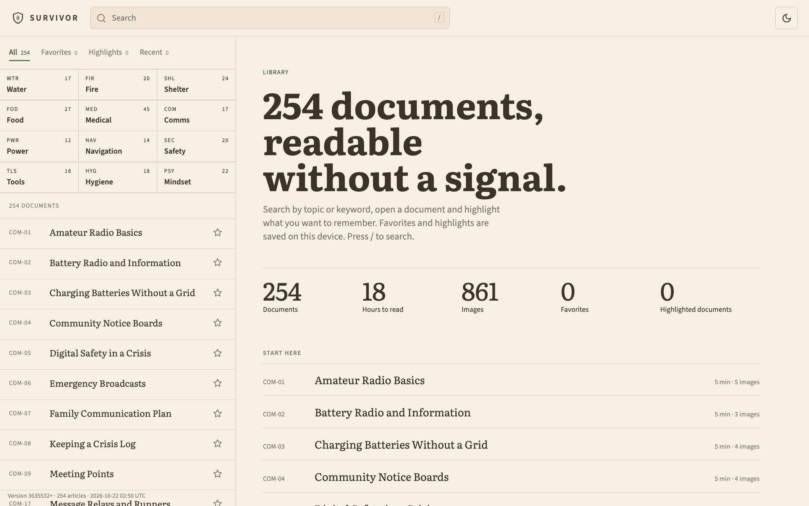
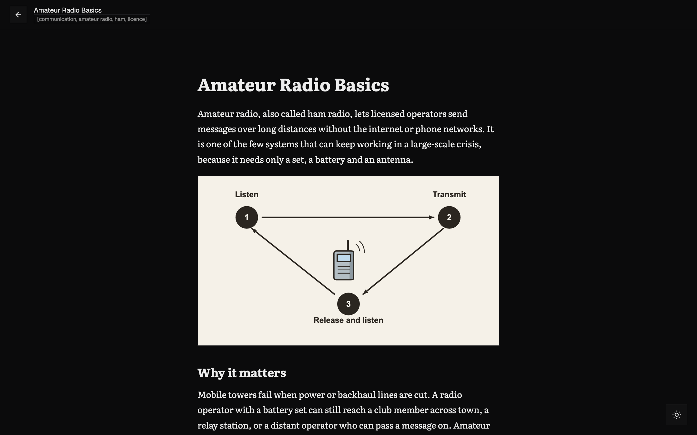
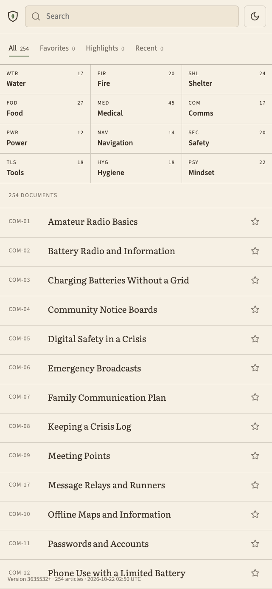
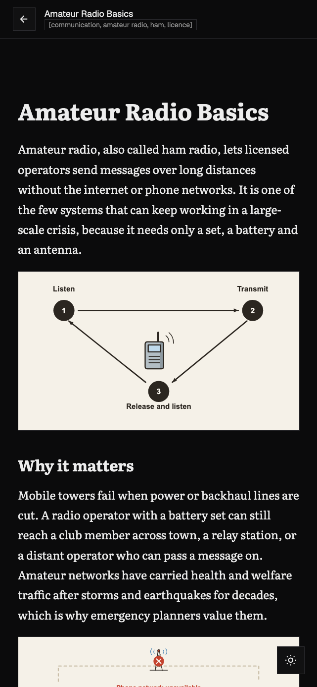

# survivor

Offline survival library: manuals on water, food, medicine, fire, shelter, communication, power, navigation, safety, tools, hygiene and mindset. Served as a static site that can be installed on a phone and used without a network.

 &nbsp; 

## Layout

- `documents/<SECTION>/*.md`: one Markdown file per article, with YAML frontmatter.
- `assets/<SECTION>/`: images referenced from the articles.
- `web/`: the static app (`index.html`, `reader.html`, fonts).
- `tools/build.py`: builds `dist/` (the site and `index.json`).
- `nginx.conf`, `Dockerfile`, `docker-compose.yml`: the container that serves `dist/`.

## Content

Twelve sections with fixed codes: WTR water, FIR fire, SHL shelter, FOD food, MED medicine, COM communication, PWR power, NAV navigation, SEC safety, TLS tools, HYG hygiene, PSY mindset. Each article is a Markdown file with illustrations; diagrams are generated from a catalog of pieces.

## Build

    python3 tools/build.py

## Run with Docker

    docker compose up -d --build

Bind to one address with `SURVIVOR_BIND`, for example `SURVIVOR_BIND=192.168.1.100 docker compose up -d --build`. The site listens on port 8092.

## Test

    python3 -m unittest discover -s tools/diagrams -p "test_*.py"

See `AGENTS.md` for the rules that apply to the content.

## Related projects

- [faro](https://github.com/soyjavi/faro): A panel for your servers and their services, where survivor shows up as a container.
- [domo](https://github.com/soyjavi/domo): A private local API for smart-home devices.
- [pozo](https://github.com/soyjavi/pozo): A daemon that keeps the latest podcast episodes downloaded.

## License

MIT, see `LICENSE`.
